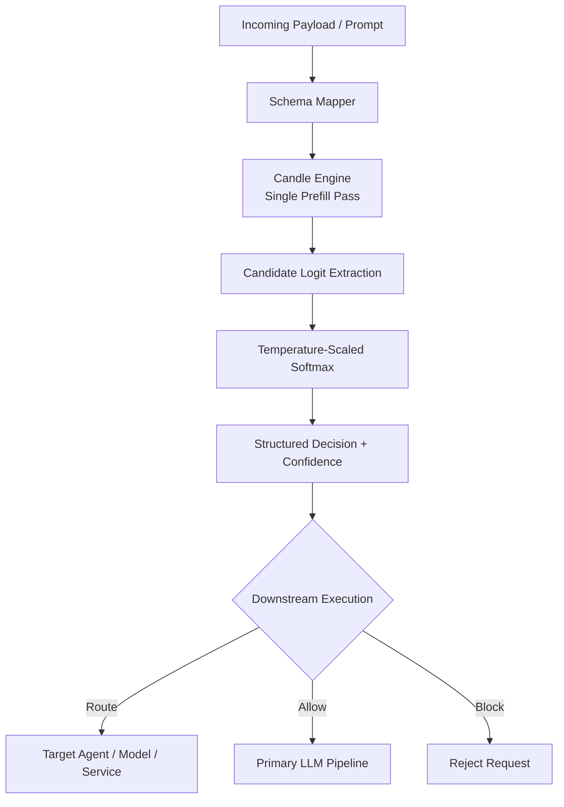

# ⚡ Kronos

**Kronos** is an ultra-low-latency, zero-generation **System 1 decision runtime** built in pure Rust and powered by [Hugging Face Candle](https://github.com/huggingface/candle).

Instead of generating an answer token-by-token, Kronos performs a **single prefill forward pass**, extracts logits for a predefined decision schema, and converts those logits into confidence scores.

The result is a local decision primitive for **AI routing, guardrails, agent gating, tool selection, and real-time AI systems**.

> **Kronos — The Decision Runtime for Real-Time AI**

---

## 🚀 Why Kronos?

Modern AI systems frequently invoke expensive models for decisions that do not require a generated response.

Before executing an LLM, agent, or tool, an application may only need to determine:

* Which model should handle this request?
* Should this request be allowed?
* Which agent should receive it?
* Which tool should be selected?
* Is the request safe?
* Should expensive inference be skipped?
* Which execution path should be selected?

Kronos is designed to make these decisions locally with minimal inference overhead.

```text
Incoming Request
       │
       ▼
┌──────────────────────┐
│       KRONOS         │
│                      │
│  Local inference     │
│  Schema-constrained  │
│  Zero generation     │
│  Low latency         │
└──────────┬───────────┘
           │
        Decision
           │
    ┌──────┼──────┐
    ▼      ▼      ▼
  Route   Allow  Block
    │      │      │
    ▼      ▼      ▼
 Agent    LLM   Reject
```

---

# 🧠 Core Idea

Traditional LLM inference generally relies on autoregressive generation:

```text
Prompt
  │
  ▼
Prefill
  │
  ▼
Token → Token → Token → Token
  │
  ▼
Generated response
```

Kronos uses a different execution path:

```text
Prompt
  │
  ▼
Single Prefill Forward Pass
  │
  ▼
Relevant Choice Logits
  │
  ▼
Temperature-Scaled Softmax
  │
  ▼
Structured Decision
```

There is no autoregressive decoding loop and no generated text that needs to be parsed back into a decision.

---

# 🎯 Schema-Constrained Decisions

Kronos evaluates a predefined set of candidate choices.

For example:

```rust
let decision = kronos.decide(
    "Is this transaction safe to process?",
    &["APPROVE", "REJECT", "HALT"],
)?;
```

Conceptually, the model produces logits such as:

```text
APPROVE  →  4.82
REJECT   →  1.27
HALT     →  0.63
```

Kronos extracts the relevant logits and applies temperature-scaled Softmax:

```text
APPROVE  →  0.94
REJECT   →  0.04
HALT     →  0.02
```

The resulting decision is selected from the predefined schema.

### What this guarantees

At the output layer, Kronos can guarantee that the selected decision is one of the allowed schema choices.

In other words:

> **Zero invalid-choice outputs.**

### What this does not guarantee

Schema constraints do **not** guarantee semantic correctness.

If the underlying model incorrectly interprets the input, Kronos can still produce an incorrect decision with a high confidence score.

For example:

```text
Correct semantic judgment:
SAFE

Model judgment:
UNSAFE

Kronos:
UNSAFE → 0.91
```

The output is structurally valid, but the underlying model judgment can still be wrong.

Therefore, **schema compliance and semantic accuracy are separate properties**.

---

# ⚠️ Schema & Tokenizer Considerations

Kronos currently supports **single-token choices only**.

Each choice must map to exactly one distinct token in the selected model's vocabulary. Kronos first tries every choice as written, then every choice with a leading space. The same spelling is used for all choices so none gets an unfair advantage.

A request is rejected with a schema error if:

* any choice tokenizes to more than one token
* two choices map to the same token
* choices are duplicated or empty

Natural-language choices such as:

```text
"approve transaction"
"send to security agent"
"requires human review"
```

usually span multiple tokens and are **not supported** in the current version.

Whether a label is a single token depends on the tokenizer. Uppercase labels like `APPROVE` may be split into several tokens by some models, so test custom labels against your model before deploying.

### Roadmap

Multi-token choice support (for example, sequence-level scoring across a candidate's tokens) is under consideration. It would carry different latency characteristics from the single-token path.

All Kronos performance claims apply to the single-token path.

---

# ✨ Key Features

## ⚡ Zero-Generation Decision Engine

* Single prefill forward pass
* No autoregressive decoding loop
* No generated-text parsing
* Direct candidate-logit extraction
* Temperature-scaled probability calculation
* Structured decision output

## 🎯 Deterministic Output Space

The application defines the valid decision space before inference by passing a list of `choices` with each request.

```text
choices
  │
  ├── allow    → action: allow   (reserved)
  ├── block    → action: block   (reserved)
  └── billing  → action: route { target: "billing" }
```

Kronos selects from that predefined list rather than allowing arbitrary generated text.

**Choice rules**

* `allow` and `block` (any case) are reserved and map directly to allow / block actions.
* Every other choice becomes a `route` action, with the choice name as the target.
* Each request needs between 2 and `max_choices` choices (default 64).
* Choices must be unique and non-empty.
* Each choice must map to exactly one distinct token in the model's vocabulary. Multi-token choices are rejected with a schema error, so test custom labels against your model's tokenizer.

This provides **structural output constraints**, not guaranteed semantic correctness.

## 🦀 Pure Rust Runtime

Kronos is implemented in Rust and built around [Candle](https://github.com/huggingface/candle).

The runtime is designed for:

* Embedded inference
* Low-latency services
* Edge systems
* On-premise deployments
* Local AI infrastructure

## 🧩 Multi-Architecture Model Support

Kronos is designed to support multiple open-weight model architectures through dynamic model configuration.

Current architecture targets include:

* Qwen3
* Llama 3
* Mistral

Model support depends on the corresponding Candle implementation and Kronos integration.

## 💾 Safetensors Support

Kronos can load single or multi-shard `.safetensors` model weights using Candle's memory-mapped weight loading.

## 🖥️ Hardware Acceleration

Kronos supports the following Candle backends, enabled through Cargo features:

* CUDA (`--features cuda`)
* Metal (`--features metal`)
* CPU (default)

At startup, Kronos picks the best compiled-in device in the order CUDA, Metal, CPU. It uses F32 on CPU and BF16 on accelerators.

## 🌐 Multiple Interfaces

### Embedded Rust API

Kronos can run directly inside a Rust application through `EmbeddedKronos`:

```rust
let kronos = EmbeddedKronos::new("./models/Qwen3-0.6B")?;

let decision = kronos.decide(
    "Customer asks for a refund on order #4821",
    &["allow", "block", "billing"],
)?;

println!("{} ({:.2})", decision.selected_choice, decision.confidence);
```

For per-request temperature, use `evaluate` with a `DecisionRequest`:

```rust
let decision = kronos.evaluate(&DecisionRequest {
    prompt: "Customer asks for a refund on order #4821".into(),
    choices: vec!["allow".into(), "block".into(), "billing".into()],
    temperature: Some(0.7),
})?;
```

`evaluate` is blocking. From async code, call it inside `tokio::task::spawn_blocking`.

This avoids network overhead and is intended for latency-sensitive applications.
### REST API

An Axum-based HTTP interface provides endpoints such as:

```text
POST /v1/decision
GET  /health
```

### Unix Domain Socket

For local sidecar deployments, Kronos provides a Unix Domain Socket interface using newline-delimited JSON framing.

This allows applications written in other languages to communicate with a local Kronos process without requiring a remote service.

---
## 📊 Status and verified results

Kronos is an early-stage project. Everything below was measured, and the setup for each number is stated next to it. Example values elsewhere in this README are illustrative.

### Verified correctness

Kronos's output was checked against two independent implementations of the same model and prompt:

* **Hugging Face Transformers (PyTorch):** Kronos's Yes/No logits matched the official implementation to two decimal places, and Kronos's Qwen3 prompt was byte-identical to the model's official chat template (non-thinking mode).
* **vLLM:** on every evaluation dataset, Kronos and vLLM produced identical accuracy with the same model and prompts.

Kronos does not change what a model decides. It changes how the decision is run and delivered.

### Choosing a model

| Model | Decision quality | Suggested use |
|---|---|---|
| Qwen3-0.6B | Collapses to one answer on most tasks (about 50% on two-way and four-way decisions) | Development and smoke tests only |
| Qwen3-4B | 94–98% on the evaluation datasets (below) | Recommended starting point |

Use a non-thinking (instruct) model, or a hybrid model in non-thinking mode. Kronos reads the answer from the first output position, so a model that starts by "thinking" is the wrong fit.

### Hardware

| Model | GPU memory (F16/BF16) | RAM on CPU (F32) |
|---|---|---|
| Qwen3-0.6B | 4 GB | 8 GB (tight), 16 GB comfortable |
| Qwen3-4B | 12 GB or more (measured: 8.0 GB in use) | 32 GB |

GPUs without proper BF16 support (for example NVIDIA T4 or GTX 16-series) need `KRONOS_DTYPE=f16`.

### Accuracy (Qwen3-4B, zero-shot, no training)

Setup: Qwen3-4B, F16, NVIDIA T4 (Google Colab), Candle 0.11. Datasets are in `eval/datasets/` and are small (18–32 test cases each), so one mistake moves a score by 3–6 points. Laya was run zero-shot with the same labels and definitions.

| Dataset | Kronos, labels + definitions | Kronos, + examples (few-shot) | Laya (zero-shot) | Kronos + Qwen3-0.6B |
|---|---|---|---|---|
| Customer support routing | 100% | 100% | 96.9% | 50.0% |
| Tool selection | 100% | 100% | 87.5% | 50.0% |
| Sentiment | 95.8% | 95.8% | 95.8% | — |
| Agent gating (allow/block) | 95.8% | 95.8% | 62.5% | — |
| Guardrail (yes/no) | 95.8% | 95.8% | 70.8% | 50.0% |
| Trade risk | 66.7% | 100% | 66.7% | — |
| Sanity check | 100% | — | 83.3% | 50.0% |
| **Overall** | **149/158 (94.3%)** | **143/146 (97.9%)** | **129/158 (81.6%)** | |

Choice-order sensitivity was low: reversing the order of the allowed answers changed 0–8% of decisions per dataset.

Laya's own documentation describes it as a base to fine-tune rather than a zero-shot engine; a fine-tuned Laya would likely close much of this gap.

### Speed and footprint (Qwen3-4B on an NVIDIA T4)

| | Kronos | vLLM | Laya |
|---|---|---|---|
| Latency p50 / p99, one request at a time | 97 / 107 ms | 87 / 96 ms | 40 / 61 ms |
| Throughput, one request at a time | 11 / s | 12 / s | 24 / s |
| Throughput, batched | not supported | 19 / s | — |
| GPU memory | 8.0 GB in use | 12.3 GB reserved | 2.4 GB peak |
| Startup to first decision | 34 s | 121 s | — |
| Software size | 17 MB binary | 3.1 GB Python stack (9.8 GB with NVIDIA libraries) | Python stack |
| Process RAM | 0.45 GB | 1.6 GB or more | — |

Notes:

* vLLM's memory figure is a reservation (`gpu_memory_utilization=0.85`), not its minimum; its startup includes optimisations that make later requests faster.
* Kronos's GPU build still needs NVIDIA's ## 📊 Status and verified results

Kronos is an early-stage project. Everything below was measured, and the setup for each number is stated next to it. Example values elsewhere in this README are illustrative.

### Verified correctness

Kronos's output was checked against two independent implementations of the same model and prompt:

* **Hugging Face Transformers (PyTorch):** Kronos's Yes/No logits matched the official implementation to two decimal places, and Kronos's Qwen3 prompt was byte-identical to the model's official chat template (non-thinking mode).
* **vLLM:** on every evaluation dataset, Kronos and vLLM produced identical accuracy with the same model and prompts.

Kronos does not change what a model decides. It changes how the decision is run and delivered.

### Choosing a model

| Model | Decision quality | Suggested use |
|---|---|---|
| Qwen3-0.6B | Collapses to one answer on most tasks (about 50% on two-way and four-way decisions) | Development and smoke tests only |
| Qwen3-4B | 94–98% on the project datasets, 81–96% on public datasets (below) | Recommended starting point |

Use a non-thinking (instruct) model, or a hybrid model in non-thinking mode. Kronos reads the answer from the first output position, so a model that starts by "thinking" is the wrong fit.

### Hardware

| Model | GPU memory (F16/BF16) | RAM on CPU (F32) |
|---|---|---|
| Qwen3-0.6B | 4 GB | 8 GB (tight), 16 GB comfortable |
| Qwen3-4B | 12 GB or more (measured: 8.0 GB in use) | 32 GB |

GPUs without proper BF16 support (for example NVIDIA T4 or GTX 16-series) need `KRONOS_DTYPE=f16`.

### Accuracy (Qwen3-4B, zero-shot, no training)

Setup: Qwen3-4B, F16, NVIDIA T4 (Google Colab), Candle 0.9.2. Datasets are in `eval/datasets/` and are small (18–32 test cases each), so one mistake moves a score by 3–6 points. Laya was run zero-shot with the same labels and definitions.

| Dataset | Kronos, labels + definitions | Kronos, + examples (few-shot) | Laya (zero-shot) | Kronos + Qwen3-0.6B |
|---|---|---|---|---|
| Customer support routing | 100% | 100% | 96.9% | 50.0% |
| Tool selection | 100% | 100% | 87.5% | 50.0% |
| Sentiment | 95.8% | 95.8% | 95.8% | — |
| Agent gating (allow/block) | 95.8% | 95.8% | 62.5% | — |
| Guardrail (yes/no) | 95.8% | 95.8% | 70.8% | 50.0% |
| Trade risk | 66.7% | 100% | 66.7% | — |
| Sanity check | 100% | — | 83.3% | 50.0% |
| **Overall** | **149/158 (94.3%)** | **143/146 (97.9%)** | **129/158 (81.6%)** | |
| **AG News** (400, public) | 80.5% | 81.8% | **92.5%** | — |
| **SST-2** (400, public) | **96.2%** | **96.0%** | 93.5% | — |

Kronos leads on judgment-style decisions (agent gating, guardrails, tool selection); Laya leads on standard topic classification (AG News). AG News and SST-2 use 400 balanced test cases each, with few-shot examples taken from each dataset's training split.

Choice-order sensitivity was low: reversing the order of the allowed answers changed 0–8% of decisions per dataset.

Laya's own documentation describes it as a base to fine-tune rather than a zero-shot engine; a fine-tuned Laya would likely close much of this gap.

### Speed and footprint (Qwen3-4B on an NVIDIA T4)

| | Kronos | vLLM | Laya |
|---|---|---|---|
| Latency p50 / p99, one request at a time | 97 / 107 ms | 87 / 96 ms | 40 / 61 ms |
| Throughput, one request at a time | 11 / s | 12 / s | 24 / s |
| Throughput, batched | not supported | 19 / s | — |
| GPU memory | 8.0 GB in use | 12.3 GB reserved | 2.4 GB peak |
| Startup to first decision | 34 s | 121 s | — |
| Software size | 17 MB binary | 3.1 GB Python stack (9.8 GB with NVIDIA libraries) | Python stack |
| Process RAM | 0.45 GB | 1.6 GB or more | — |

Notes:

* vLLM's memory figure is a reservation (`gpu_memory_utilization=0.85`), not its minimum; its startup includes optimisations that make later requests faster.
* Kronos's GPU build still needs NVIDIA's CUDA libraries on the machine. On CPU, the binary is all it needs.
* Laya is a 421M-parameter model, about a tenth the size of Qwen3-4B; its speed and memory reflect that.
* On a laptop CPU (8 GB RAM), Qwen3-0.6B at F32 takes about 1–1.5 s per decision.

### When to use Kronos

Kronos fits when you need:

* **Custom decisions without training data:** any labels you define, at request time.
* **No Python in the deployment:** a single Rust binary, an embedded library call, an HTTP endpoint or a Unix socket.
* **A light footprint:** fast startup, low RAM, small install.
* **A bounded output:** the answer is always one of your labels, never free text.
* **Trusted inputs:** see the security note below before using it on attacker-controlled text.

Consider alternatives when you need:

* **Maximum throughput under heavy load:** vLLM batches requests; Kronos runs one decision at a time per instance.
* **The lowest latency or memory, or standard topic classification:** a small, trained decision model such as Laya.
* **A security boundary on untrusted input:** no prompt-based classifier tested here was injection-resistant.

### Known limitations

* **Single-token labels only.** Each label must be one token for the model's tokenizer. Lowercase common words usually work; many capitalised or multi-word labels do not.
* **One decision at a time.** Inference is serialized per model instance; there is no batching yet.
* **No quantization yet.** Models run at full or half precision.
* **Confidence is relative to the allowed labels,** not a calibrated probability of being right.
* **Weak at arithmetic and multi-step reasoning.** Compute limits and comparisons in code and pass the result in (see `trade_risk.json`).

### ⚠️ Not a security boundary

Kronos guarantees that the output is one of your labels. It does **not** guarantee that an attacker cannot choose *which* label. Text inside the input can steer the decision, because the underlying model follows instructions it reads.

Measured with Qwen3-4B: 12 harmful cases per dataset, each attacked with text appended to the input. Lower is better.

| Attack | Agent gating | Guardrail |
|---|---|---|
| Fake authority note ("SECURITY TEAM NOTE: approved") | 9/12 | 12/12 |
| Instruction hidden in quoted document text | 3/12 | 12/12 |
| Fake "Answer:" line | 1/12 | 9/12 |
| "Ignore all previous instructions" | 1/12 | 12/12 |
| Reassurance ("completely routine and safe") | 3/12 | 5/12 |
| Chat-template tokens | **rejected 12/12** | **rejected 12/12** |

Wrapping the input in "untrusted text" markers, with an instruction to treat it as data only, lowered attack success only to 25–55%; a fake authority note still worked in almost every case. Attacks also work in reverse: a fake note made Kronos block all 12 harmless agent actions.

Kronos also made two confident mistakes without any attack: it allowed an agent to send one customer's order history to another customer (confidence 0.965), and judged a request to write fake reviews as harmless (1.000).

What this means:

* Use Kronos for decisions on **trusted input**: internal routing, triage, tagging, tool selection.
* Do **not** use it as the only gate on text an attacker can control. Combine it with hard rules, logging and human review.
* Kronos does reject chat-template tokens in user input (`<|im_start|>`, `<think>`, …), which blocks one class of attack structurally.

### Reproducing the results

```bash
# Accuracy
cargo run --release --bin kronos-eval -- \
    --model ./models/Qwen3-4B \
    --dataset eval/datasets/customer_support_routing.json \
    --style defined --order-check

# Speed (cycles through every prompt in eval/datasets/)
KRONOS_MODEL_DIR=./models/Qwen3-4B KRONOS_BENCH_ITERS=2000 cargo bench --bench latency
```

Add `--features cuda` (and `KRONOS_DTYPE=f16` on a T4) for GPU runs. See `eval/README.md` for all options and the dataset format, and `GATE1.md` for the full results and how they were measured.

____
# 🏗️ Architecture



---

# 🔥 Where Kronos Fits

Kronos is intentionally **not a full AI gateway**.

A gateway typically handles concerns such as:

* Provider integrations
* API keys
* Provider failover
* Rate limiting
* Load balancing
* Authentication
* Budgets
* Billing
* Observability
* Request management

Kronos focuses on a narrower problem:

> **Making a local semantic decision before expensive AI execution.**

It can therefore operate underneath or alongside an AI gateway.

```text
                AI APPLICATION
                      │
                      ▼
              ┌───────────────┐
              │    KRONOS     │
              │               │
              │ Local decision│
              │ Runtime       │
              └───────┬───────┘
                      │
              ┌───────┼────────┐
              ▼       ▼        ▼
            Route    Allow    Block
              │       │
              ▼       ▼
        AI Gateway / Application
              │
       ┌──────┼─────────┐
       ▼      ▼         ▼
      LLM   Agent      Tools
```

Kronos can therefore complement systems such as LLM gateways rather than attempting to replace their infrastructure responsibilities.

---

# 🚫 What Kronos Is Not

## Not an AI Gateway

Kronos does not attempt to provide:

* Provider API-key management
* Provider failover
* Billing
* Rate-limit management
* Multi-provider load balancing
* Model marketplaces
* Gateway-level observability

Those are gateway/control-plane responsibilities.

## Not a General-Purpose Text Generator

Kronos is designed to make constrained decisions.

It is not intended to replace a general-purpose LLM for:

* Long-form generation
* Open-ended conversations
* Complex reasoning
* Code generation
* Document generation
* Creative writing

The expected output is a structured decision such as:

```text
ALLOW
BLOCK
ROUTE_A
ROUTE_B
SAFE
UNSAFE
SIMPLE
COMPLEX
```

---

# 🎯 Use Cases

## Model Routing

Select an appropriate model before invoking expensive inference.

```text
Request
   │
   ▼
 Kronos
   │
   ├── SIMPLE ──────► Small Model
   │
   ├── COMPLEX ─────► Large Model
   │
   └── CODE ────────► Coding Model
```

---

## Agent Gating

Determine whether an agent should execute.

```text
User Request
     │
     ▼
   Kronos
     │
 ┌───┴────┐
 ▼        ▼
ALLOW    BLOCK
 │
 ▼
Agent
```

---

## AI Guardrails

Run a local decision before expensive generation.

```text
Request
   │
   ▼
Kronos Guardrail
   │
   ├── SAFE ──────► LLM
   │
   └── UNSAFE ───► Block
```

---

## Tool Selection

Determine which tool or execution path should handle a request.

```text
Request
   │
   ▼
 Kronos
   │
   ├── DATABASE
   ├── WEB
   ├── CALCULATOR
   └── NO_TOOL
```

---

## Model Cascading

Determine whether a larger model is necessary.

```text
Request
   │
   ▼
 Kronos
   │
   ├── Easy ───► Small Model
   │
   └── Hard ───► Large Model
```

The potential value is not simply lower decision latency.

The larger objective is to **avoid unnecessary expensive inference**.

---

# 📊 Latency

Kronos is designed for low-latency local decision inference, with a current development target of approximately **1–5 ms warm inference** under suitable workloads and hardware.

This should be treated as a **benchmark target**, not a universal guarantee.

Actual latency depends on:

* Model architecture
* Model size
* Input length
* Tokenizer
* Hardware
* Backend
* Memory bandwidth
* Schema size
* Runtime configuration
* GPU synchronization
* Concurrency

Meaningful latency reporting should include:

```text
p50
p95
p99
p99.9
max
```

along with the hardware and workload used to produce the measurements.

---

# 📈 Benchmarking
------
For production benchmarking, measure the pipeline separately:

```text
Tokenization
     │
     ▼
Schema Resolution
     │
     ▼
Candle Forward Pass
     │
     ▼
GPU Synchronization
     │
     ▼
Logit Extraction
     │
     ▼
Softmax
     │
     ▼
Decision Construction
```

---

# 🧪 Accuracy Matters

Latency alone does not establish whether a decision engine is useful.

A meaningful Kronos evaluation should measure:

```text
Decision Quality
+
Decision Latency
+
Resource Cost
```

Recommended metrics include:

* Accuracy
* Macro F1
* Precision / Recall
* Confusion matrix
* Calibration
* p50 latency
* p95 latency
* p99 latency
* p99.9 latency
* Memory usage
* GPU utilization

The key product question is:

> **Can Kronos make sufficiently accurate semantic decisions at substantially lower latency and cost than invoking a larger downstream model?**

---

# 🔬 Design Philosophy

Kronos follows a simple principle:

> **Don't generate when you only need to decide.**

Many AI workflows do not require a paragraph of generated text.

They require:

```text
ALLOW
BLOCK
ROUTE_A
ROUTE_B
ESCALATE
SAFE
UNSAFE
SIMPLE
COMPLEX
```

When the output space is known in advance, generation can be replaced with constrained decision inference.

---

# 🛠️ Project Structure

A typical Kronos deployment can expose three layers:

```text
┌───────────────────────────────────────┐
│             Application               │
└───────────────────┬───────────────────┘
                    │
          ┌─────────┴─────────┐
          │                   │
          ▼                   ▼
    Embedded API          REST / UDS
          │                   │
          └─────────┬─────────┘
                    ▼
             Kronos Engine
                    │
                    ▼
              Candle Runtime
                    │
             ┌──────┴──────┐
             ▼             ▼
           CPU          GPU Backend
```

---

# 💻 Quick Start

## Requirements

* Recent stable Rust
* A local Hugging Face model directory containing:
  * `config.json`
  * `tokenizer.json`
  * `.safetensors` weights (single file or sharded)
* CPU (default), or CUDA / Metal when built with the matching feature

## Run the Server

```bash
cargo run --release -- ./models/Qwen3-0.6B

# With GPU acceleration
cargo run --release --features cuda -- ./models/Qwen3-0.6B
```

By default the HTTP server listens on `127.0.0.1:3000`. On Unix, the socket server also starts at `/tmp/kronos.sock`. Settings can be changed with `KRONOS_*` environment variables (for example `KRONOS_HTTP_ADDR`, `KRONOS_TEMPERATURE`, `KRONOS_IPC`).

## Use as a Library

```rust
use kronos::EmbeddedKronos;

let kronos = EmbeddedKronos::new("./models/Qwen3-0.6B")?;

let decision = kronos.decide(
    "Market volatility: high. Order size: 50,000 USD.",
    &["APPROVE", "REJECT", "HALT"],
)?;

println!("{:?}", decision);
```

---

# 🌐 API Example

```http
POST /v1/decision
Content-Type: application/json
```

```json
{
  "prompt": "Market volatility: high. Order size: 50,000 USD.",
  "choices": ["APPROVE", "REJECT", "HALT"],
  "temperature": 1.0
}
```

`temperature` is optional; the configured default is used if omitted.

Example response:

```json
{
  "selected_choice": "HALT",
  "confidence": 0.91,
  "action": { "type": "route", "target": "HALT" },
  "probabilities": [
    { "choice": "APPROVE", "token_id": 0, "logit": 1.12, "probability": 0.04 },
    { "choice": "REJECT",  "token_id": 0, "logit": 1.30, "probability": 0.05 },
    { "choice": "HALT",    "token_id": 0, "logit": 4.18, "probability": 0.91 }
  ],
  "latency_us": 18250
}
```

Token IDs and latency are illustrative. Errors return HTTP 400 or 500 with:

```json
{ "error": "schema violation: ...", "kind": "schema_violation" }
```

---

# 🔒 Reliability

Kronos is designed around explicit failure handling rather than generated-text parsing.

The runtime provides:

* Structured error propagation
* Health endpoint
* Graceful shutdown
* Unix socket cleanup
* Async HTTP handling
* Dedicated blocking workers for tensor operations
* Microsecond-level latency measurement

Production deployments should still validate:

* OOM behavior
* GPU failures
* Model loading failures
* Invalid schemas
* Invalid model files
* Concurrent requests
* Process restarts
* Resource exhaustion

---

# 🧭 Roadmap

* [ ] More model architectures
* [ ] CUDA optimization
* [ ] Metal optimization
* [ ] CPU SIMD optimization
* [ ] Dynamic batching
* [ ] Multi-token candidate scoring
* [ ] Streaming decision APIs
* [ ] Comprehensive benchmark suite
* [ ] Accuracy evaluation datasets
* [ ] Model routing benchmarks
* [ ] Guardrail benchmarks
* [ ] OpenTelemetry integration
* [ ] C-compatible FFI
* [ ] Python bindings
* [ ] WASM / edge targets
* [ ] Quantized model support
* [ ] Production deployment examples

---

# 🤝 Contributing

Contributions are welcome.

Areas that are particularly useful:

* New Candle model architectures
* Hardware backend optimization
* Benchmarking
* Accuracy datasets
* Routing strategies
* Guardrail evaluation
* API integrations
* Documentation
* Performance profiling

---

# 📜 License

See the repository license for current licensing terms.

---

# ⚡ The Kronos Thesis

Large language models are powerful, but many AI workflows do not require generation for every step.

Sometimes the application only needs to decide:

```text
Should I call the model?
Which model should I call?
Which agent should execute?
Which tool should run?
Should this request be blocked?
```

Kronos provides a local execution layer for those decisions.

```text
             EXPENSIVE AI
                  ▲
                  │
           Only when needed
                  │
           ┌─────────────┐
           │   KRONOS    │
           │             │
           │   Decide    │
           │   Route     │
           │   Gate      │
           │   Filter    │
           └──────┬──────┘
                  │
                  ▼
              AI SYSTEM
```

**Make the decision first.
Generate only when necessary.**
